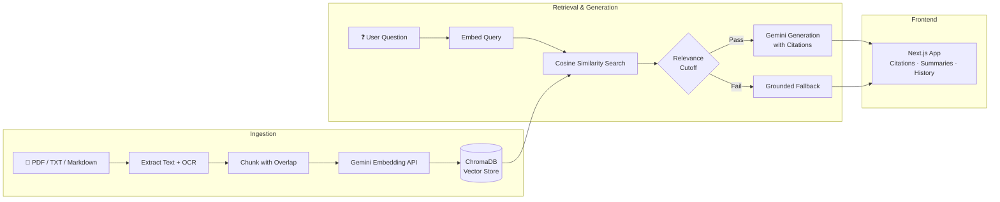

<div align="center">

# 📄 DocQ&A

### *Turn any document into a conversational knowledge base — powered by Gemini AI*

<br/>

[](https://rag-app-blush.vercel.app)
[](https://subornoroychowdhury7-afk.github.io/rag_app/)
[](https://rag-app-1-rqg6.onrender.com/health)

[](https://github.com/subornoroychowdhury7-afk/rag_app/actions/workflows/ci.yml)
[](https://github.com/subornoroychowdhury7-afk/rag_app/actions/workflows/deploy.yml)
[](https://nextjs.org)
[](https://fastapi.tiangolo.com)
[](https://ai.google.dev)
[](https://www.trychroma.com)

<br/>

> **No sign-in. No setup friction. Upload a document and start asking questions in seconds.**

</div>

---

## ✨ What is DocQ&A?

DocQ&A is a **Retrieval-Augmented Generation (RAG)** application that lets you chat with your documents using natural language. Drop in a research paper, legal contract, technical manual, or any text-heavy file — and instantly get accurate, cited answers powered by Google's Gemini AI.

Every answer is **grounded in your documents** with source citations and relevance scores, so you always know exactly where the information comes from.

---

## 🎯 Key Features

| Feature | Description |
|---------|-------------|
| **📁 Multi-Format Upload** | PDF (with OCR fallback for scanned pages), plain text, and Markdown — up to 20 MB |
| **💬 Conversational Q&A** | Full multi-turn chat history with context-aware follow-up suggestions |
| **📌 Source Citations** | Every answer includes the source document, chunk text, and a relevance percentage |
| **🔍 Document Focus** | Ask across your entire library or pin the conversation to one specific document |
| **📊 Executive Summaries** | One-click AI briefings with highlights, takeaways, and recommended follow-ups |
| **🗑️ Document Management** | List, inspect chunk counts, and permanently delete indexed documents |
| **🌓 Theme Toggle** | Full light and dark mode support |
| **⚡ Zero Auth Friction** | No account, no sign-in — open the app and go |

---

## 🏗️ Architecture



**The pipeline:**
1. Documents are **chunked with overlap** (default 1 800 chars / 180 overlap) to preserve context at boundaries.
2. Each chunk is vectorised using **`models/gemini-embedding-2`** (768 dimensions).
3. At query time the question is embedded and top-K chunks are retrieved by **cosine similarity**.
4. A **relevance cutoff** (default 0.65) ensures only truly relevant passages reach the model.
5. Gemini generates a grounded answer — if no chunks qualify, a graceful fallback is returned instead of a hallucination.

---

## 🚀 Live Deployments

| Surface | URL | Notes |
|---------|-----|-------|
| **Frontend (Vercel)** | [rag-app-blush.vercel.app](https://rag-app-blush.vercel.app) | Primary production frontend |
| **Frontend (GitHub Pages)** | [subornoroychowdhury7-afk.github.io/rag_app](https://subornoroychowdhury7-afk.github.io/rag_app/) | Static export, auto-deployed on push |
| **Backend API (Render)** | [rag-app-1-rqg6.onrender.com](https://rag-app-1-rqg6.onrender.com) | FastAPI + ChromaDB |
| **API Docs (Swagger)** | [/docs](https://rag-app-1-rqg6.onrender.com/docs) | Interactive OpenAPI spec |
| **Container (GHCR)** | `ghcr.io/subornoroychowdhury7-afk/rag_app/backend:latest` | Published on every push to `main` |

---

## 🛠️ Run Locally

**Prerequisites:** Python 3.12, Node.js ≥ 20, and a [Google Gemini API key](https://ai.google.dev/gemini-api/docs/api-key).  
Tesseract OCR is optional — scanned PDFs automatically fall back to Gemini's native PDF transcription when Tesseract is not found.

### 1 · Backend

```powershell
cd backend
py -3.12 -m venv .venv
.\.venv\Scripts\Activate.ps1
pip install -r requirements.txt
Copy-Item .env.example .env   # then set GEMINI_API_KEY inside .env
uvicorn main:app --reload
```

API available at **`http://localhost:8000`** · Swagger docs at **`http://localhost:8000/docs`**.

### 2 · Frontend

```powershell
cd frontend
npm install
```

Create `frontend/.env.local`:

```env
NEXT_PUBLIC_API_URL=http://localhost:8000
```

```powershell
npm run dev
```

Open **`http://localhost:3000`**, upload a document, and start asking questions.

---

## ⚙️ Configuration Reference

### Backend (`backend/.env`)

| Variable | Default | Purpose |
|----------|---------|---------|
| `GEMINI_API_KEY` | **required** | Embeddings, generation, and Gemini OCR fallback |
| `EMBEDDING_MODEL` | `models/gemini-embedding-2` | Gemini embedding model |
| `EMBEDDING_DIM` | `768` | Output dimensionality |
| `GENERATION_MODEL` | `gemini-2.5-flash` | Answer and summary generation |
| `CHUNK_SIZE` | `1800` | Characters per chunk |
| `CHUNK_OVERLAP` | `180` | Overlap between adjacent chunks |
| `MAX_DISTANCE` | `0.65` | Cosine distance cutoff (0 = identical) |
| `MAX_UPLOAD_MB` | `20` | Maximum file upload size |
| `CHROMA_PATH` | `./chroma_db` | Local vector store path |
| `CHROMA_API_KEY` | *(optional)* | Enables Chroma Cloud mode |
| `CHROMA_TENANT` | *(optional)* | Chroma Cloud tenant |
| `CHROMA_DATABASE` | *(optional)* | Chroma Cloud database |
| `ALLOWED_ORIGINS` | `*` | CORS allowed origins |

### Frontend (`frontend/.env.local`)

| Variable | Purpose |
|----------|---------|
| `NEXT_PUBLIC_API_URL` | Backend base URL |
| `NEXT_PUBLIC_BASE_PATH` | Base path for GitHub Pages (set automatically in CI) |

---

## 📡 API Reference

| Method | Endpoint | Description |
|--------|----------|-------------|
| `GET` | `/health` | Backend and configuration health check |
| `GET` | `/documents` | List all indexed documents with chunk counts |
| `POST` | `/upload` | Ingest a PDF, TXT, or Markdown file |
| `POST` | `/chat` | Retrieve relevant passages and generate a cited answer |
| `POST` | `/documents/{filename}/summarize` | Generate an executive AI briefing for a document |
| `DELETE` | `/documents/{filename}` | Remove a document and all its chunks from the index |

Full interactive schema at [`/docs`](https://rag-app-1-rqg6.onrender.com/docs).

---

## 🚢 Deployment Guide

### GitHub Pages (Frontend)
1. Go to **Settings → Pages** in your repository.
2. Under **Build and deployment → Source**, select **GitHub Actions**.
3. Push to `main` or trigger the **Deploy** workflow manually.
4. The frontend builds as a static export and deploys to `https://<username>.github.io/<repo>/`.

### Render (Backend)
1. Connect your repository on [Render](https://render.com) via the **Blueprint** option (`render.yaml`) or a **Web Service** pointing to `backend/Dockerfile`.
2. Add `GEMINI_API_KEY` as an environment variable in the Render dashboard.
3. Add `RENDER_DEPLOY_HOOK_URL` as a GitHub repository secret to trigger Render redeploys from CI.

### Vercel (Frontend Alternative)
Import the repository on [Vercel](https://vercel.com), set the root directory to `frontend`, and configure:
- `NEXT_PUBLIC_API_URL` → your Render backend URL

### GitHub Actions CI/CD

| Workflow | Trigger | Jobs |
|----------|---------|------|
| **`ci.yml`** | Push & PR to `main` | Backend unit tests · Frontend lint & build · Docker validation |
| **`deploy.yml`** | Push to `main` | Deploy to GitHub Pages · Publish image to GHCR · Trigger Render webhook |

---

## 📁 Project Structure

```text
rag-app/
├── backend/
│   ├── main.py              # FastAPI app — ingestion, retrieval, generation
│   ├── test_api.py          # Unit tests (unittest + FastAPI TestClient)
│   ├── Dockerfile           # Production container (python:3.12-slim + Tesseract)
│   ├── requirements.txt     # Python dependencies
│   └── .env.example         # Environment variable template
├── frontend/
│   ├── src/
│   │   ├── app/             # Next.js App Router pages
│   │   ├── components/      # Chat, Header, DocumentList, etc.
│   │   └── lib/             # API client and type definitions
│   ├── next.config.ts       # Next.js config (static export support)
│   └── package.json
├── .github/
│   └── workflows/
│       ├── ci.yml           # Continuous integration
│       └── deploy.yml       # Continuous deployment
├── render.yaml              # Render service definition
└── README.md
```

---

## 🤝 Contributing

1. Fork the repository and create a feature branch.
2. Run backend tests: `python -m unittest discover -s backend`
3. Run frontend checks: `cd frontend && npm run lint && npm run build`
4. Open a pull request — CI validates your changes automatically.

> **Never commit** API keys, `.env` files, or local vector store data (`chroma_db/`).

---

<div align="center">

Built with ❤️ using **Next.js 16 · FastAPI · ChromaDB · Google Gemini AI**

</div>
