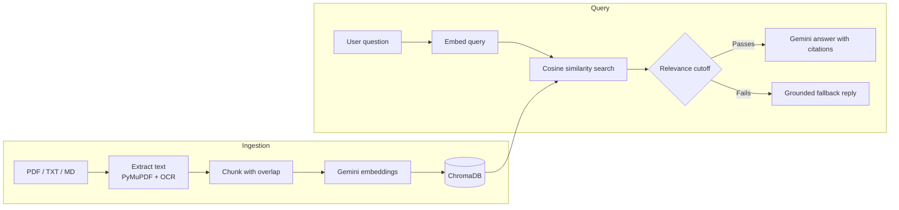

# DocQ&A

**Turn any document into a conversational knowledge base.** Upload a PDF, text file, or Markdown file, ask questions in plain English, and get answers grounded in retrieved passages — with source citations and suggested follow-up questions.

[](https://rag-app-blush.vercel.app)
[](https://subornoroychowdhury7-afk.github.io/rag_app/)
[](https://rag-app-1-rqg6.onrender.com/health)
[](https://github.com/subornoroychowdhury7-afk/rag_app/actions)
[](https://github.com/subornoroychowdhury7-afk/rag_app/actions)
[](https://nextjs.org)
[](https://fastapi.tiangolo.com)
[](https://www.trychroma.com)
[](https://ai.google.dev)

---

## Features

| Feature | Details |
|---|---|
| Multi-format uploads | PDF (embedded text + OCR fallback), TXT, and Markdown up to 20 MB |
| Semantic search | Gemini embeddings + ChromaDB cosine similarity retrieval |
| Conversational Q&A | Ask follow-up questions; session history is preserved |
| Source citations | Every answer links the exact document passages it used |
| Document-scoped chat | Ask across your full library or focus on a single file |
| Executive summaries | One-click AI briefing with key highlights and recommendations |
| Dark / light mode | System preference detected automatically |
| No sign-in required | Open to all; no account needed |

---

## Architecture



**Backend** — FastAPI handles document ingestion, chunking, embedding, retrieval, summarization, and Gemini generation. Local ChromaDB persists the vector store; Chroma Cloud is also supported.

**Frontend** — Next.js 16 App Router with TypeScript communicates with the FastAPI service via a typed API client.

---

## Run Locally

### Prerequisites

- Python 3.12
- Node.js 20 with npm
- A [Google Gemini API key](https://ai.google.dev/gemini-api/docs/api-key)
- _(Optional)_ Tesseract OCR — if absent, Gemini handles scanned PDF transcription automatically

### 1. Backend

```powershell
cd backend
py -3.12 -m venv .venv
.\.venv\Scripts\Activate.ps1
python -m pip install -r requirements.txt
Copy-Item .env.example .env
```

Open `backend/.env` and set your API key:

```env
GEMINI_API_KEY=your_key_here
```

Start the server:

```powershell
uvicorn main:app --reload
```

The API is now live at `http://localhost:8000`. Interactive Swagger docs are at `http://localhost:8000/docs`.

### 2. Frontend

Open a **second terminal**:

```powershell
cd frontend
npm install
```

Create `frontend/.env.local`:

```env
NEXT_PUBLIC_API_URL=http://localhost:8000
```

Start the dev server:

```powershell
npm run dev
```

Open [http://localhost:3000](http://localhost:3000), upload a document, and start chatting.

---

## Configuration Reference

### Backend (`backend/.env`)

| Variable | Default | Description |
|---|---|---|
| `GEMINI_API_KEY` | _(required)_ | Powers embeddings, generation, summaries, and Gemini OCR fallback |
| `EMBEDDING_MODEL` | `models/gemini-embedding-2` | Gemini embedding model |
| `EMBEDDING_DIM` | `768` | Output vector dimensions |
| `GENERATION_MODEL` | `gemini-2.5-flash` | Gemini generation model |
| `CHUNK_SIZE` | `1800` | Characters per chunk during ingestion |
| `CHUNK_OVERLAP` | `180` | Character overlap between adjacent chunks |
| `MAX_DISTANCE` | `0.65` | Cosine distance cutoff — passages above this are discarded |
| `MAX_UPLOAD_MB` | `20` | Maximum accepted file size in megabytes |
| `CHROMA_PATH` | `./chroma_db` | Local ChromaDB persistence directory |
| `ALLOWED_ORIGINS` | `*` | CORS allowed origins (comma-separated for multiple) |

#### Chroma Cloud (optional)

Set these three variables to switch from local ChromaDB to Chroma Cloud:

```env
CHROMA_API_KEY=...
CHROMA_TENANT=...
CHROMA_DATABASE=...
```

### Frontend (`frontend/.env.local`)

| Variable | Description |
|---|---|
| `NEXT_PUBLIC_API_URL` | Full URL of the FastAPI backend |

---

## API Reference

| Method | Endpoint | Description |
|---|---|---|
| `GET` | `/health` | Service health and Gemini key status |
| `GET` | `/documents` | List all indexed documents with chunk counts |
| `POST` | `/upload` | Ingest a PDF, TXT, or Markdown file |
| `POST` | `/chat` | Answer a question using retrieved context |
| `POST` | `/documents/{filename}/summarize` | Generate an executive AI briefing |
| `DELETE` | `/documents/{filename}` | Remove a document from the vector store |

Full interactive schema available at `/docs` (Swagger UI) or `/redoc` when the backend is running.

---

## Deployment

### GitHub Pages — Frontend

1. Go to your repository **Settings > Pages**.
2. Under **Build and deployment > Source**, select **GitHub Actions**.
3. Push to `main` or trigger the workflow manually under **Actions > Deploy**.
4. The frontend will be published to `https://<username>.github.io/<repo>/`.

### Render — Backend API

1. Connect your repository on [Render](https://render.com) using **New > Blueprint** — this reads `render.yaml` automatically.
2. Set the `GEMINI_API_KEY` environment variable in the Render dashboard.
3. Render builds the Docker image from `backend/Dockerfile` on every push to `main`.

### Vercel — Frontend Alternative

Import the repository on [Vercel](https://vercel.com) and set `NEXT_PUBLIC_API_URL` to your Render backend URL (e.g. `https://rag-app-1-rqg6.onrender.com`). Vercel handles builds and deploys automatically.

### GitHub Actions CI/CD

| Workflow | Trigger | What it does |
|---|---|---|
| `ci.yml` | Push / PR to `main` | Backend unit tests, frontend ESLint + build, Docker build validation |
| `deploy.yml` | Push to `main` | Deploys to GitHub Pages, pushes Docker image to GHCR, optionally triggers Render and Vercel redeploys |

**Repository secrets used:** `RENDER_DEPLOY_HOOK_URL`, `VERCEL_TOKEN`, `VERCEL_ORG_ID`, `VERCEL_PROJECT_ID`, `NEXT_PUBLIC_API_URL`

---

## Project Structure

```
rag-app/
├── backend/
│   ├── main.py              # FastAPI app — ingestion, retrieval, generation
│   ├── requirements.txt     # Python dependencies
│   ├── Dockerfile           # Container definition for Render / GHCR
│   ├── .env.example         # Environment variable template
│   └── test_api.py          # Backend unit tests
├── frontend/
│   ├── src/
│   │   ├── app/             # Next.js App Router pages and layouts
│   │   ├── components/      # React UI components
│   │   └── lib/             # API client and utilities
│   ├── next.config.ts       # Next.js configuration
│   └── package.json
├── .github/
│   └── workflows/
│       ├── ci.yml           # Continuous integration
│       └── deploy.yml       # Continuous deployment
├── render.yaml              # Render Blueprint service definition
└── README.md
```

---

## Troubleshooting

| Symptom | Likely Cause | Fix |
|---|---|---|
| `GEMINI_API_KEY is not configured` in logs | Missing or placeholder key | Set `GEMINI_API_KEY` in `backend/.env` |
| Upload returns 422 "No extractable text" | Scanned PDF, no embedded text, no Tesseract | Install Tesseract or ensure your Gemini API key is valid (Gemini handles OCR fallback) |
| CORS errors in the browser | `ALLOWED_ORIGINS` does not include the frontend URL | Add your frontend origin to `ALLOWED_ORIGINS` in the backend env |
| GitHub Pages shows a blank page | Static export or base path not configured | Ensure `OUTPUT_EXPORT=true` during build and Pages source is set to **GitHub Actions** |
| Render cold-start delay | Free-tier instance sleeps after inactivity | Expected on the Render free plan; the first request wakes the service |

---

## Contributing

1. Fork the repository and create a feature branch.
2. Run backend tests (`python -m unittest discover -s backend`) and frontend lint + build (`npm run lint && npm run build` inside `frontend/`) before opening a PR.
3. Update this README if setup steps, environment variables, or API behaviour changes.
4. Never commit API keys, `.env` files, database files (`*.db`), or local vector-store data (`chroma_db/`).

