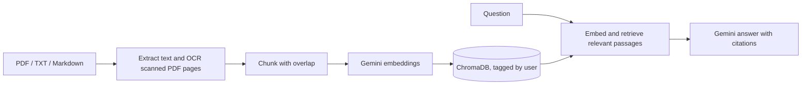

# DocQ&A

**Turn your documents into a searchable, conversational knowledge base.** Upload a PDF, text, or Markdown file, ask questions in plain language, and get answers grounded in retrieved passages with source citations.

[](https://rag-app-blush.vercel.app)
[](https://subornoroychowdhury7-afk.github.io/rag_app/)
[](https://rag-app-1-rqg6.onrender.com/health)
[](https://github.com/subornoroychowdhury7-afk/rag_app/actions)
[](https://nextjs.org)
[](https://fastapi.tiangolo.com)

## What you can do

- Create an account and keep each user's document collection scoped to that account.
- Upload PDF, TXT, and Markdown files (20 MB maximum by default). PDFs use embedded text where available, with OCR for scanned pages.
- Ask questions across your library or focus a conversation on one selected document.
- Review the passages and source files behind an answer, request an executive summary, or remove a document.
- Switch between light and dark themes.

## How it works



For questions, the backend searches only the signed-in user's indexed content. It applies a relevance cutoff before generation and returns a grounded fallback when no passages qualify. The frontend is a Next.js app; the FastAPI service handles authentication, ingestion, retrieval, summaries, and document management.

## Run locally

You’ll need Python 3.12, Node.js with npm, and a [Google Gemini API key](https://ai.google.dev/gemini-api/docs/api-key). Tesseract OCR is optional; scanned PDFs can use Gemini transcription when Tesseract is unavailable.

### 1. Start the backend

```powershell
cd backend
py -3.12 -m venv .venv
.\.venv\Scripts\Activate.ps1
python -m pip install -r requirements.txt
Copy-Item .env.example .env
```

Set `GEMINI_API_KEY` and a long, random `JWT_SECRET` in `backend/.env`, then run:

```powershell
uvicorn main:app --reload
```

The API will be available at `http://localhost:8000`; interactive API docs are at `http://localhost:8000/docs`.

### 2. Start the frontend

In a second terminal:

```powershell
cd frontend
npm install
```

Create `frontend/.env.local` with:

```env
NEXT_PUBLIC_API_URL=http://localhost:8000
```

Then start Next.js:

```powershell
npm run dev
```

Open `http://localhost:3000`, register, and upload a document to begin.

## Configuration

| Variable | Purpose |
| --- | --- |
| `GEMINI_API_KEY` | Required for embeddings, answers, summaries, and Gemini PDF OCR fallback. |
| `JWT_SECRET` | Secret used to sign login tokens; use a private, persistent value. |
| `NEXT_PUBLIC_API_URL` | Backend URL used by the frontend. |
| `CHROMA_PATH`, `AUTH_DB_PATH` | Local vector-store and SQLite account database paths (defaults: `./chroma_db` and `./auth.db`). |
| `EMBEDDING_MODEL`, `EMBEDDING_DIM`, `GENERATION_MODEL` | Gemini model settings; defaults are in `backend/.env.example`. |
| `MAX_UPLOAD_MB`, `CHUNK_SIZE`, `CHUNK_OVERLAP`, `MAX_DISTANCE` | Optional ingestion and retrieval tuning; defaults: `20`, `1800`, `180`, and `0.65`. |
| `TOKEN_TTL_HOURS`, `ALLOWED_ORIGINS` | Optional session lifetime and CORS settings; defaults: `168` hours and `*`. |

For Chroma Cloud, configure `CHROMA_API_KEY`, `CHROMA_TENANT`, and `CHROMA_DATABASE` on the backend. When using local storage in a hosted environment, attach persistent storage for both the vector database and SQLite account database so data survives restarts and redeploys.

## API overview

| Method | Endpoint | Purpose |
| --- | --- | --- |
| `POST` | `/auth/register`, `/auth/login` | Create an account or start a session. |
| `GET` | `/auth/me`, `/documents` | Check the session and list indexed files. |
| `POST` | `/upload` | Ingest a supported document. |
| `POST` | `/chat` | Retrieve relevant passages and answer a question. |
| `POST` | `/documents/{filename}/summarize` | Generate a document briefing. |
| `DELETE` | `/documents/{filename}` | Delete a document from the signed-in user's index. |
| `GET` | `/health` | Check backend availability. |

All document and chat endpoints require a Bearer token. FastAPI's interactive schema is available at `/docs` when the backend is running.

## Deployment

### 1. GitHub Pages (Frontend)
The frontend can be deployed directly to GitHub Pages via the included GitHub Actions workflow (`.github/workflows/deploy.yml`):
1. In your GitHub repository, navigate to **Settings** > **Pages**.
2. Under **Build and deployment** > **Source**, choose **GitHub Actions**.
3. Push to `main` (or run the workflow manually under **Actions** > **Deploy**).
4. Your frontend will be live at `https://<username>.github.io/<repo>/` and preconfigured to communicate with the Render API.

### 2. Render (Backend API)
The FastAPI backend is deployed using `render.yaml` and `backend/Dockerfile`:
- Connect your GitHub repository on [Render](https://render.com) using the Blueprint option or Web Service.
- Set `GEMINI_API_KEY` and any desired authentication secrets.
- Initial owner account is automatically seeded on startup so account access persists even across free-tier container restarts.

### 3. Vercel (Frontend Alternative)
The Next.js frontend can also be deployed to [Vercel](https://vercel.com). Configure `NEXT_PUBLIC_API_URL` to point to your live Render backend URL (`https://rag-app-1-rqg6.onrender.com`).

### 4. GitHub Actions CI/CD
- **`.github/workflows/ci.yml`**: Runs full backend test suites (`test_auth_flow.py`), frontend linting, Next.js build verification, and Docker validation on pull requests and pushes.
- **`.github/workflows/deploy.yml`**: Automatically deploys the frontend to GitHub Pages, publishes backend Docker images to GitHub Container Registry (GHCR), and triggers Render redeployments via webhook when `RENDER_DEPLOY_HOOK_URL` is set in repository secrets.

## Project layout

```text
backend/    FastAPI API, authentication, document processing, and vector search
frontend/   Next.js App Router interface
render.yaml Render service definition
```

## Contributing

Keep changes focused, update this README when setup or behavior changes, and run the relevant frontend lint/build or backend checks before opening a pull request. Never commit API keys, `.env` files, account databases, or local vector-store data.
